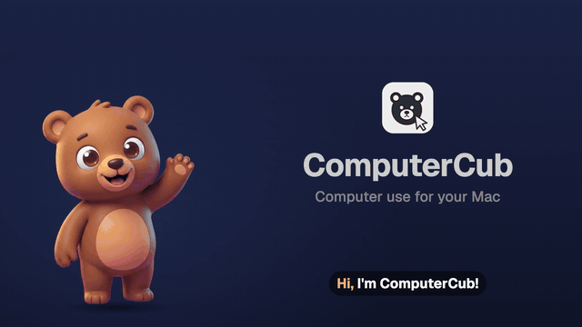
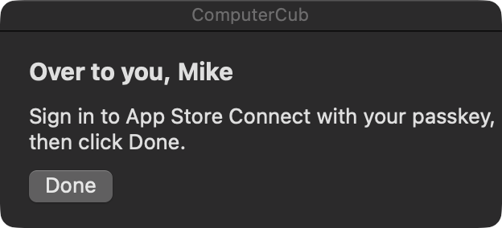
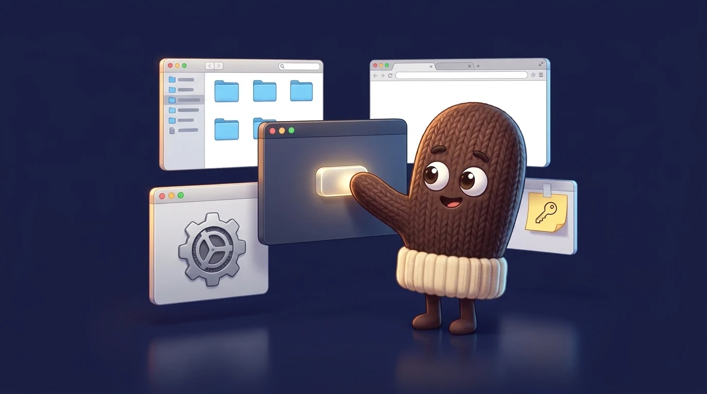
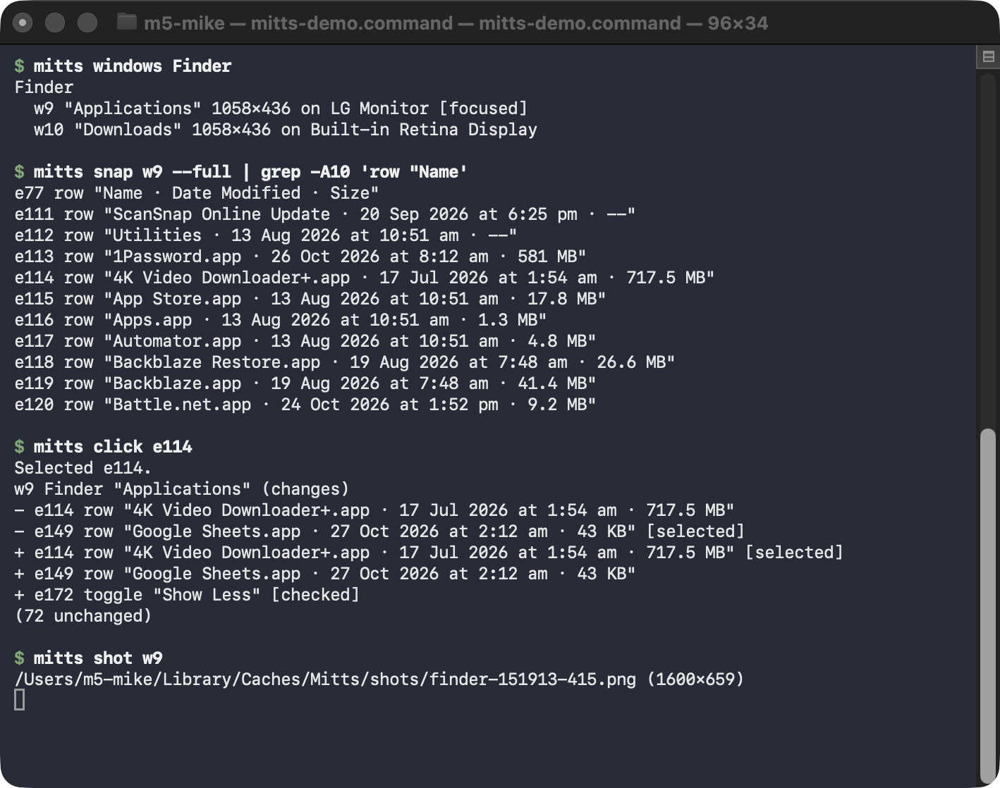

#  ComputerCub

Computer use for your Mac: lets your AI agents click around in its apps

macOS 14 or later

<!-- media: hero -->
<a href="docs/media/computercub.mp4"></a>

<sub>24 s. Click for the video with sound.</sub>
<!-- /media: hero -->

## What it is

I wanted my agents to be able to use the apps on my Mac, not just the terminal. I'd been leaning on Codex's computer use for that, but in October 2026 the ChatGPT app added a check that locked out the little bridge I'd built on top of it, so I figured it was time to have one of my own.

It's the desktop sibling of [BrowserBear](https://github.com/mikecann/browserbear), my Chrome extension for agents (they're both named for Threadbear, the app I run my agents in). BrowserBear drives web pages from the inside, and ComputerCub does everything else: Finder, System Settings, Xcode, file pickers, permission dialogs, and the Chrome pages extensions aren't allowed anywhere near, like the Chrome Web Store developer dashboard.

It reads windows through the macOS Accessibility API rather than screenshots, so your agent gets a short list of the things it can click or type in, each with a ref like `e12`, and every click answers with just what changed. A look at a window is usually well under a thousand tokens and takes under a second, and it works on windows that are behind other windows or on another display without moving your mouse.

When it hits a password, a passkey or a 2FA code it doesn't try to be clever. It pops up a little panel on that window and waits for you to click Done.





## Get it

Paste this into your AI coding agent (Claude Code, Codex, Cursor...):

> Fork https://github.com/mikecann/computercub to my GitHub account and clone my fork
> (if I don't use GitHub, or want to keep my copy private, just clone it instead),
> then make it my own. It's one of Mike Cann's personal tools, so read the README
> first, change anything specific to his setup to suit mine, then help me get it
> running.

### Or set it up by hand

You'll need macOS 14 or later, Git, and Xcode or the Command Line Tools with Swift 6 or later. Run `xcode-select --install` first if you need them.

```bash
git clone https://github.com/mikecann/computercub.git
cd computercub
./scripts/install.sh
computercub doctor
```

That builds `~/Applications/ComputerCub.app`, links `computercub` into `~/.local/bin`, and links the agent skill into `~/.claude/skills` and `~/.codex/skills` if you have those folders, so Claude Code and Codex know it's there. Add `~/.local/bin` to your PATH if it isn't already.

`computercub doctor` starts the app, and the first time a setup window opens with a row for each permission: Accessibility (it can't do anything without it) and Screen Recording (only for screenshots). Each row has an Open Settings button that goes straight to the right place in System Settings, and turns green within a second of you switching it on. `computercub setup` brings the window back, and so does opening ComputerCub.app while it's running. macOS only hands Screen Recording to an app when it starts, so the window offers a restart if it hasn't taken, and if you turn it on while ComputerCub is running, the next screenshot restarts it for you.

It signs with your first Apple Development identity if you have one, so the permissions stick around when you rebuild. Without one it signs ad hoc and macOS asks again after every build.

## Using it

```bash
computercub windows                                 # every app's windows, with refs and which display
computercub snap Finder                             # what you can click or type in, as e12-style refs
computercub snap "System Settings" --find Privacy   # just the controls that mention Privacy, however far down
computercub click e23
computercub press w2 cmd+shift+g                    # keys go to the app, even in the background
computercub type e57 "~/Downloads" --submit
computercub menu Finder "File > New Finder Window"
computercub drag e19 e18                            # a real mouse drag, like a file onto a folder
computercub move w2 100 80 1200 800                 # move and resize a window
computercub read "System Settings"                  # the words, for reading values off a window
computercub snap "Chrome:Work"                      # Chrome's toolbar, tabs and the page
computercub shot w2                                 # a PNG of just that window
computercub handoff "Chrome:App Store" "Sign in with your passkey, then click Done" --wait 300
```

`computercub help` lists everything.

This is what an agent sees and gets back, in Finder:



- **Windows** are named by what they are: an app (`Finder`), an app and part of a title (`"Chrome:Web Store"`), or the `w3` ref from `computercub windows`, which sticks to that window while it's open, even if ComputerCub restarts. Chrome puts the profile name at the end of its window titles, so `"Chrome:Work"` finds the right profile.
- **Refs** like `e12` stay on the same control between looks. After the first `snap` you only get what changed, and clicking, typing and keys answer with that diff, plus any new window or sheet the app opened, so there's no need to look again.
- **No mouse by default.** Clicks go through the Accessibility API, so they don't move your pointer or bring anything to the front. `click --double` opens things (a Finder sidebar item, a file) through Accessibility too. For the odd control that only answers a mouse, `--mouse` sends the click to the window's own process, so your pointer stays put and the window stays behind yours (it uses private SkyLight calls, the way Warp and cua do). `--pointer` is the real thing for what that misses, such as hover-only controls, and takes your pointer while it does. For windows that show nothing to Accessibility, such as iPhone Mirroring, `click`, `swipe` and `type` take a window and a position from its last shot and work from the background too, so an agent can use your phone while you use your Mac. Scrolling a list on the phone is the exception: the mirror only takes a scroll with the real pointer over it, so `scroll` borrows your pointer for about a second there. Keys don't bring anything forward either. macOS only fires cmd shortcuts in the active app, so `press` finds the menu item with that shortcut and presses it instead (cmd+w on a window without tabs presses its close button). Return and Escape become the focused control's Confirm and Cancel, and Escape on a Save or Open sheet presses its Cancel button. Other keys go straight to the app's process. When none of that can reach the window (a menu item the app greys out while it's in the background, or keys for a Save or Open panel, which runs in its own process), ComputerCub says so and sends nothing, and the agent decides whether it's worth `--front`. Only with `--front` does the window come forward for a moment, on `press`, `type` (which then clicks the field: what Finder's page for a plugged-in iPhone needs) and `scroll`. Anything you type during that moment is held and lands in your own app once it's back in front.
- **You can see where it is.** The window an agent is working in gets a blue glowing outline, with the ComputerCub bear peering over the top, so you know which window to leave alone. Hover over the bear to see which agent it is (Claude, Codex...). The outline follows the window around, stays behind anything you have in front, and fades out a few seconds after the agent's last command. Click the bear to stop the agent: ComputerCub then refuses that window until you tell the agent to carry on and it runs `computercub resume`.
- **Passwords** are masked in snapshots, and `computercub type` refuses to type into password fields. That's what `handoff` is for.
- **Screenshots** are of one window or one element, never the whole screen. They're shrunk to 1600 px and deleted after an hour, or straight away with `computercub clean`.

## How it works

```
computercub (the command your agent runs)
  → ComputerCub.app, a background app with no Dock icon, over a Unix socket
    in ~/Library/Application Support/ComputerCub
  → the macOS Accessibility API, and ScreenCaptureKit for screenshots
```

macOS gives Accessibility and Screen Recording to whichever app started a process, so a plain command-line tool run by an agent would borrow the grants of your terminal or agent app. Instead the `computercub` command hands each request to ComputerCub.app, which holds the permissions itself under its own code signature. The command starts the app the first time you use it. [Peekaboo](https://github.com/openclaw/Peekaboo) does much the same thing with its bridge.

For Chrome and other Chromium browsers it asks for their web accessibility tree, which they only build when something like a screen reader is listening.

## Not yet

- Windows on other Spaces don't show up, because macOS only lists the current Space's.
- Nothing can see or use windows while the screen is locked, because macOS hides them from Accessibility. Commands say so and fail; `computercub apps` and listing with `computercub menu` still answer.
- Chrome stops updating a page's tree while its window is completely covered.
- No right-click menus yet, and mouse-wheel scrolling only for windows with nothing in Accessibility (iPhone Mirroring), with the real pointer. Dragging uses the real mouse, so it brings the window forward for a moment.
- Nothing asks before an agent posts, sends or deletes something. Tell your agent to ask you first.

## Development

```bash
swift build
.build/debug/computercub serve &      # the debug build as the background app
computercub doctor                    # the installed command talks to it
computercub quit
./scripts/install.sh            # the signed release app
```

Running the debug build as the service from your terminal borrows your terminal's permissions, which saves granting them to every build. `AGENTS.md` has more for agents working on it.

## Art

`docs/header.webp` is a generated banner for the public site. `icons/computercub.svg` is the app icon, a cub with a mouse pointer in the same colours as BrowserBear's paw, and `icons/computercub.png` is rendered from it. `icons/peek.png` is the generated cub that peers over the window an agent is in.

## More tools

You can find my other tools at [mikerosoft.app](https://mikerosoft.app).

MIT licensed.
