#  mitts

Lets your AI agents click around in the apps on your Mac

macOS 14 or later

<!-- media: hero -->


<!-- /media: hero -->

## What it is

I wanted my agents to be able to use the apps on my Mac, not just the terminal. I'd been leaning on Codex's computer use for that, but in October 2026 the ChatGPT app added a check that locked out the little bridge I'd built on top of it, so I figured it was time to have one of my own.

It's the desktop sibling of [Paws](https://github.com/mikecann/paws), my Chrome extension for agents. Paws drives web pages from the inside, and Mitts does everything else: Finder, System Settings, Xcode, file pickers, permission dialogs, and the Chrome pages extensions aren't allowed anywhere near, like the Chrome Web Store developer dashboard.

It reads windows through the macOS Accessibility API rather than screenshots, so your agent gets a short list of the things it can click or type in, each with a ref like `e12`, and every click answers with just what changed. A look at a window is usually well under a thousand tokens and takes under a second, and it works on windows that are behind other windows or on another display without moving your mouse.

When it hits a password, a passkey or a 2FA code it doesn't try to be clever. It pops up a little panel on that window and waits for you to click Done.


## Get it

Paste this into your AI coding agent (Claude Code, Codex, Cursor...):

> Fork https://github.com/mikecann/mitts to my GitHub account and clone my fork
> (if I don't use GitHub, or want to keep my copy private, just clone it instead),
> then make it my own. It's one of Mike Cann's personal tools, so read the README
> first, change anything specific to his setup to suit mine, then help me get it
> running.

### Or set it up by hand

You'll need macOS 14 or later, Git, and Xcode or the Command Line Tools with Swift 6 or later. Run `xcode-select --install` first if you need them.

```bash
git clone https://github.com/mikecann/mitts.git
cd mitts
./scripts/install.sh
mitts doctor
```

That builds `~/Applications/Mitts.app`, links `mitts` into `~/.local/bin`, and links the agent skill into `~/.claude/skills` and `~/.codex/skills` if you have those folders, so Claude Code and Codex know it's there. Add `~/.local/bin` to your PATH if it isn't already.

`mitts doctor` starts the app, and the first time macOS asks for two permissions. Turn on Mitts in **System Settings > Privacy & Security > Accessibility** (it can't do anything without that) and **Screen & System Audio Recording** (only needed for screenshots), then run `mitts doctor` again to check.

It signs with your first Apple Development identity if you have one, so the permissions stick around when you rebuild. Without one it signs ad hoc and macOS asks again after every build.

## Using it

```bash
mitts windows                                 # every app's windows, with refs and which display
mitts snap Finder                             # what you can click or type in, as e12-style refs
mitts click e23
mitts press w2 cmd+shift+g                    # keys go to the app, even in the background
mitts type e57 "~/Downloads" --submit
mitts menu Finder "File > New Finder Window"
mitts read "System Settings"                  # the words, for reading values off a window
mitts snap "Chrome:Work"                      # Chrome's toolbar, tabs and the page
mitts shot w2                                 # a PNG of just that window
mitts handoff "Chrome:App Store" "Sign in with your passkey, then click Done" --wait 300
```

`mitts help` lists everything.

- **Windows** are named by what they are: an app (`Finder`), an app and part of a title (`"Chrome:Web Store"`), or the `w3` ref from `mitts windows`, which sticks to that window while it's open. Chrome puts the profile name at the end of its window titles, so `"Chrome:Work"` finds the right profile.
- **Refs** like `e12` stay on the same control between looks. After the first `snap` you only get what changed, and clicking, typing and keys answer with that diff, plus any new window or sheet the app opened, so there's no need to look again.
- **No mouse by default.** Clicks go through the Accessibility API, so they don't move your pointer or bring anything to the front. `--mouse` does a real click for the odd control that needs one, and `press --front` brings the window forward for keys that only work in the active app (Chrome's cmd+w is one), then gives you back whatever you had in front.
- **Passwords** are masked in snapshots, and `mitts type` refuses to type into password fields. That's what `handoff` is for.
- **Screenshots** are of one window or one element, never the whole screen. They're shrunk to 1600 px and deleted after an hour, or straight away with `mitts clean`.

## How it works

```
mitts (the command your agent runs)
  → Mitts.app, a background app with no Dock icon, over a Unix socket
    in ~/Library/Application Support/Mitts
  → the macOS Accessibility API, and ScreenCaptureKit for screenshots
```

macOS gives Accessibility and Screen Recording to whichever app started a process, so a plain command-line tool run by an agent would borrow the grants of your terminal or agent app. Instead the `mitts` command hands each request to Mitts.app, which holds the permissions itself under its own code signature. The command starts the app the first time you use it. [Peekaboo](https://github.com/openclaw/Peekaboo) does much the same thing with its bridge.

For Chrome and other Chromium browsers it asks for their web accessibility tree, which they only build when something like a screen reader is listening.

## Not yet

- Windows on other Spaces don't show up, because macOS only lists the current Space's.
- Chrome stops updating a page's tree while its window is completely covered.
- No mouse-wheel scrolling, drag and drop or right-click menus yet.
- Nothing asks before an agent posts, sends or deletes something. Tell your agent to ask you first.

## Development

```bash
swift build
.build/debug/mitts serve &      # the debug build as the background app
mitts doctor                    # the installed command talks to it
mitts quit
./scripts/install.sh            # the signed release app
```

Running the debug build as the service from your terminal borrows your terminal's permissions, which saves granting them to every build. `AGENTS.md` has more for agents working on it.

## Art

`docs/header.webp` is a generated banner for the public site. `icons/mitts.svg` is drawn in the same colours as Paws' icon, and `icons/mitts.png` is rendered from it.

## More tools

You can find my other tools at [mikerosoft.app](https://mikerosoft.app).

MIT licensed.
